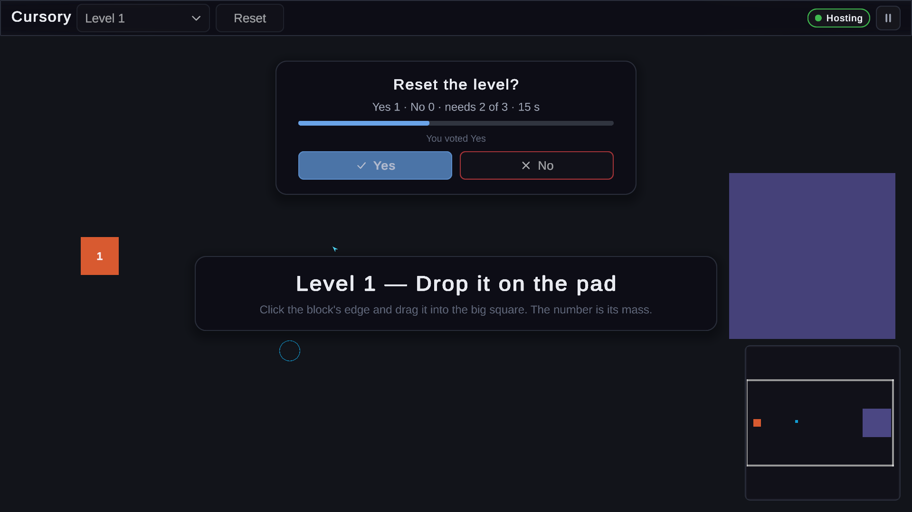
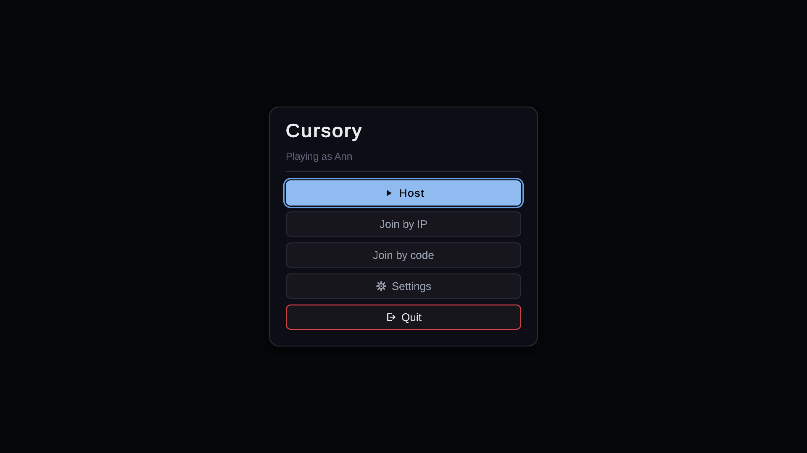
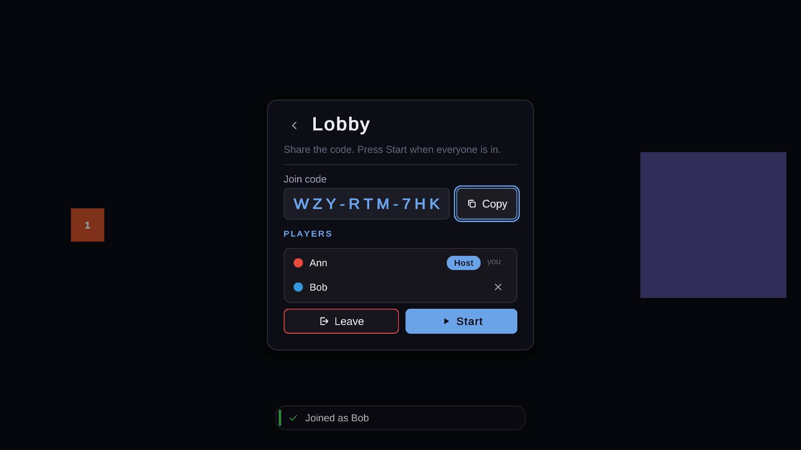

# Unity.Cursory

Cursory, the wordless co-op physics puzzle, rebuilt in Unity 6: every player is a cursor on a rope, and heavy blocks only move when several players pull together. Host, join by IP or code, or run a dedicated server.

[](https://unity.com/releases/editor/archive)
[](https://learn.microsoft.com/dotnet/csharp/)
[](#quick-start)
[](docs/hosting.md)
[](https://github.com/mindattic/Unity.Multiplayer)
[](#limitations)



Try it: on Windows, clone the repo with its sibling packages and run `deploy.bat` (see [Quick start](#quick-start)).

## Why

- Play a puzzle where the heavy blocks need teamwork: a block's Mass says how many cursors it takes to move it, and you find out by pulling together.
- Say everything without words: a whistle (a coloured ripple and your own tone) is the whole vocabulary.
- Play from one player's PC or a headless server, with the same build and the same scene.
- Join with a short code like `WZY-RTM-7HK` instead of an IP address, and come back to your own seat after a drop.
- See a complete game on the [Unity.Multiplayer kit](https://github.com/mindattic/Unity.Multiplayer/blob/main/docs/articles/kit.md): its first example, with no menu, build or deploy code of its own.

## Features

### The puzzle

- Cursory's 14 levels, ported one for one, with their original Masses (1 to 2.6) on Unity Physics2D: real rigid bodies and friction joints, so cooperative drags, pivots and torque come out of the solver.
- Your cursor is a light physical body pulled toward your pointer (shown as a faint ghost) by a spring capped at your pull strength. Grab anywhere on a body's rim and a real rope ties the two: it has a maximum length, wraps the body's corners, and pulls both ways, so a load heavier than you drags your cursor toward it, pulling round a corner spins the body toward you, and two players on opposite ends can turn a bar that one can't.
- Blocks and compound shapes to push onto goal pads, and a circuit level where you carry wire ends onto terminals to light a bulb.
- A per-player setting in the Esc menu: cursor collision with walls and shapes.
- Votes for Reset and for switching level (2/3 quorum, 15 seconds), shown in an overlay with the live tally.
- Whistles: click empty space to send a ripple in your colour with your own tone.

### Multiplayer

- Main menu with Host, Join by IP, Join by code, Settings and Quit; your name and colour come from your MindAttic profile.



- The host's lobby shows the join code with a Copy button and the live roster; Start takes everyone in.



- The server owns the simulation; clients send only intents (move, grab, release, whistle, vote).
- Plain-words dialogs for every way a session ends, automatic reconnect to the same seat, and an Esc menu with Invite players and the player settings.
- A HUD built from MindAttic Components: toolbar with level picker, Reset, connection status and pause, a level banner, toasts and a minimap that pans the camera.

### Server and testing

- One command builds and runs the headless Linux server, locally under Docker or on a VPS, through Unity.Multiplayer's `mp-host game`.
- Two headless bots join a dedicated server by code and solve level 2 together, in a PlayMode test and nightly under Docker Compose.

## Quick start

### Prerequisites

- Windows 10 or 11 and Unity 6000.4.3f1 (add Linux Dedicated Server Build Support to run a server).
- The sibling repos checked out next to this one, because `Packages/manifest.json` references them by `file:../../` path: [Unity.Multiplayer](https://github.com/mindattic/Unity.Multiplayer), [MindAttic.Components](https://github.com/mindattic/MindAttic.Components), [Unity.Shared](https://github.com/mindattic/Unity.Shared) and [MindAttic.Capture](https://github.com/mindattic/MindAttic.Capture).
- For a server: Docker Desktop (Local) or a Linux VPS with Docker (GenericVps).

```text
<workspace>\
  Unity.Cursory\
  Unity.Multiplayer\
  MindAttic.Components\
  Unity.Shared\
  MindAttic.Capture\
```

### Play

Close the Unity Editor on the project, then run:

```powershell
.\deploy.bat
```

It pulls the latest commit, builds the Windows Release player (only when `Assets`, `Packages` or `ProjectSettings` changed since the last deploy), publishes it to `C:\Apps\Unity.Cursory`, points the `Unity.Cursory` Desktop shortcut at `deploy.bat`, and launches the game. After that, the shortcut is the way in. `tools\deploy.ps1 -DryRun` only says whether it would rebuild; the build log is `Logs\deploy-build.log`.

To play from the editor instead, open the project in Unity 6000.4.3f1 and press Play on `Assets/Unity.Cursory/Scenes/Main.unity`.

### Host or join a game

1. Host: choose **Host** on the main menu. The lobby shows a join code to share, or, when no code can be published, "Players join by IP at your LAN address and port". Press **Start** when everyone is in.
2. Join by IP: choose **Join by IP** and type the host's address, `192.168.1.20` or `192.168.1.20:7777` (the port defaults to 7777/UDP).
3. Join by code: choose **Join by code** and type the code. Case and dashes don't matter, and a misread `0`/`O` or `1`/`I` is corrected.

Codes come from a rendezvous service. The Local and GenericVps server profiles run one on port 8080; point a player at it with `Unity.Cursory.exe -rendezvous http://<server>:8080`. With no rendezvous URL the game is hosted anyway and players join by IP.

### Run a dedicated server

From the repo folder:

```powershell
./deploy.ps1 -Profile Local              # build the headless Linux server and run it with rendezvous under Docker Desktop
./deploy.ps1 -Profile Local -Down        # stop it
./deploy.ps1 -DryRun                     # print every step of a GenericVps deploy without doing it
./deploy.ps1 --public-address <vps ip>   # GenericVps (the default): your own UDP-capable Linux VPS
```

`deploy.ps1` is a thin call to Unity.Multiplayer's `mp-host game local | deploy | down --project .`; with `mp-host` installed (Unity.Multiplayer's `tools/install-mp-host.ps1`) you can run `mp-host game local` directly. It finds the editor, builds the server package from `Main.unity` and runs it. Players then join the server's address by IP, or its code by **Join by code**. Profiles, credentials and RunPod are in [docs/hosting.md](docs/hosting.md).

### Watch two bots solve level 2

```powershell
mp-host game smoke
```

It builds one Linux player and runs a dedicated server on level 2, the rendezvous service and two bots (A and B, from `mp-host.json`) under Docker Compose, and exits 0 once both bots log `OK:`.

## How it works

```text
                 Unity.Cursory (one scene: Main.unity)
  +------------------------------------------------------------------+
  | NetworkManager GameObject                                        |
  |   NetBootstrap  ---- Host / Server / Client, chosen by NetLaunch |
  |   NetFrontEnd   ---- menus, lobby, dialogs, Esc menu             |
  |   LevelServer   ---- server only: levels, Physics2D, votes       |
  +------------------------------------------------------------------+
        |  [ToServer] Move, Grab, Release, Whistle, StartVote
        v
  Server: ServerSimulation steps PhysicsWorld once per network tick
        |  [Synced] cursor positions, ropes, level progress
        |  NetKey bodies (by level id), geometry once per level
        v
  Every client: CursoryClient draws the world, HUD and minimap
```

- **Core** (`Assets/Unity.Cursory/Core`) is engine-free: levels, goals, the circuit, rope geometry, vote kinds and the bot plan, tested with plain `dotnet test`.
- **Runtime** (`Assets/Unity.Cursory/Runtime`) is the networking, physics, presentation and the bot strategy, on Unity.Multiplayer, Netcode for GameObjects, MindAttic Components and URP 2D.
- The server owns the simulation (BIBLE UC-LAW-1). A headless process (`-batchmode`, a dedicated server build or a `-bot`) builds no menus and draws nothing.

For a file-by-file walkthrough of how Cursory uses each piece of the kit (the manifest, `LevelServer`, the networked entities and their attributes, the roster, the front end, the HUD, votes, objects by key, bots, tests and hosting), read the library's [Case study: Unity.Cursory](https://github.com/mindattic/Unity.Multiplayer/blob/main/docs/articles/case-study-cursory.md). To start a game of your own on the same kit, read [Getting started: a new game](https://github.com/mindattic/Unity.Multiplayer/blob/main/docs/articles/getting-started.md).

## Project layout

| Path | What |
|---|---|
| `Assets/Unity.Cursory/Core` | Engine-free rules: model, levels, rules, physics geometry, presentation maths, bot plan |
| `Assets/Unity.Cursory/Runtime` | Net entities, server, physics, presentation, whistles, bots |
| `Assets/Unity.Cursory/Levels` | The 14 level assets, L01 to L14 |
| `Assets/Unity.Cursory/Scenes/Main.unity` | The one scene for players, the server and bots |
| `Assets/Unity.Cursory/Editor` | Project setup, asset writers and the Windows Release build |
| `Assets/Unity.Cursory/Tests/PlayMode` | PlayMode suites |
| `Tests/Core.Tests` | `dotnet test` project for Core (in `Core.slnx`) |
| `deploy.bat`, `tools/deploy.ps1` | Windows client deploy |
| `deploy.ps1`, `mp-host.json` | Dedicated server deploy and its defaults |
| `.github/workflows/nightly.yml` | Nightly dotnet, PlayMode and Docker Compose bot smoke |

## Building

The Windows Release player alone, with the editor closed:

```powershell
powershell -File tools/unity.ps1 -Method Unity.Cursory.EditorTools.CursoryBuild.BuildWindowsRelease -Graphics
```

The dedicated server package is built by `mp-host game` (above) with the library's batch build; the output goes to the git-ignored `Builds/ServerPackage`.

## Testing

The engine-free rules, no Unity needed:

```powershell
dotnet test Core.slnx
```

The PlayMode suite (`Unity.Cursory.PlayMode.Tests`: server physics, networked cursors over loopback, levels and wins, votes and whistles, ropes, the HUD and front end, and the two-bot end-to-end test) runs from the editor's Test Runner, or in batch mode:

```powershell
Unity -batchmode -nographics -projectPath . -runTests -testPlatform PlayMode -assemblyNames Unity.Cursory.PlayMode.Tests
```

`.github/workflows/nightly.yml` runs both every night, plus the bot smoke under Docker Compose through Unity.Multiplayer's reusable `game-smoke.yml`.

## Limitations

- Windows is the only client the repo builds and deploys; the server is Linux only.
- Cursory's switch tiles, doors and shape attachments are not ported.
- The project needs its sibling repos checked out beside it; the packages are not published to a registry.
- Join by code needs a reachable rendezvous service; without one, players join by IP.

## Documentation

- [docs/BIBLE.md](docs/BIBLE.md): what the game is and is not, its laws and its verified state.
- [docs/hosting.md](docs/hosting.md): the client and server deploys, profiles, credentials and the bot smoke.
- [docs/USER_STORIES.md](docs/USER_STORIES.md): the ticket chain.
- [docs/rfc/0001-port-plan.md](docs/rfc/0001-port-plan.md): the port plan; the full design is Unity.Multiplayer's [RFC 0001](https://github.com/mindattic/Unity.Multiplayer/blob/main/docs/rfc/0001-architecture.md).
- Unity.Multiplayer's docs: [the kit](https://github.com/mindattic/Unity.Multiplayer/blob/main/docs/articles/kit.md), [Case study: Unity.Cursory](https://github.com/mindattic/Unity.Multiplayer/blob/main/docs/articles/case-study-cursory.md), [Getting started](https://github.com/mindattic/Unity.Multiplayer/blob/main/docs/articles/getting-started.md) and [Porting a game](https://github.com/mindattic/Unity.Multiplayer/blob/main/docs/articles/porting.md).
- Agents: [AGENTS.md](AGENTS.md).

## License

This repo has no LICENSE file; all rights are reserved. Cursory's original Blazor version is [mindattic/Cursory](https://github.com/mindattic/Cursory).

Part of [MindAttic](https://mindattic.com) — see more projects at [github.com/mindattic](https://github.com/mindattic). Related: [Unity.Multiplayer](https://github.com/mindattic/Unity.Multiplayer), [MindAttic.Components](https://github.com/mindattic/MindAttic.Components), [Unity.Shared](https://github.com/mindattic/Unity.Shared).
